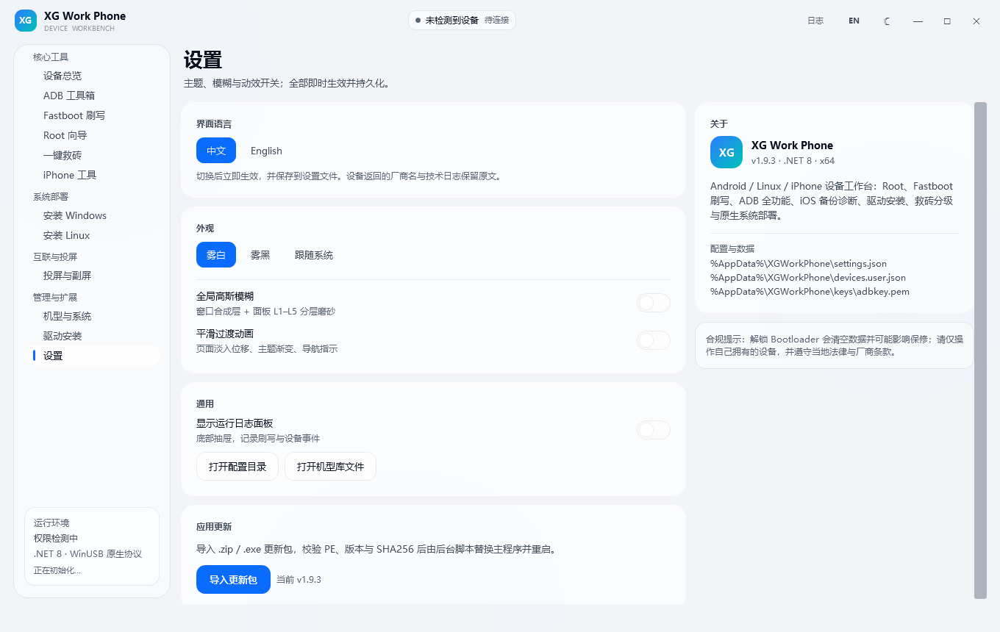
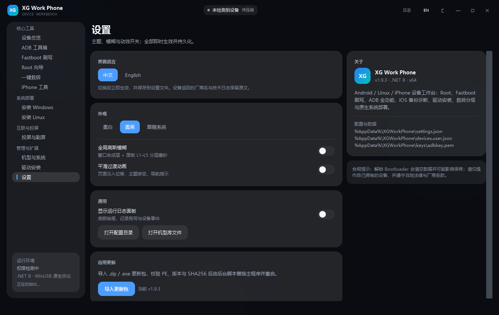
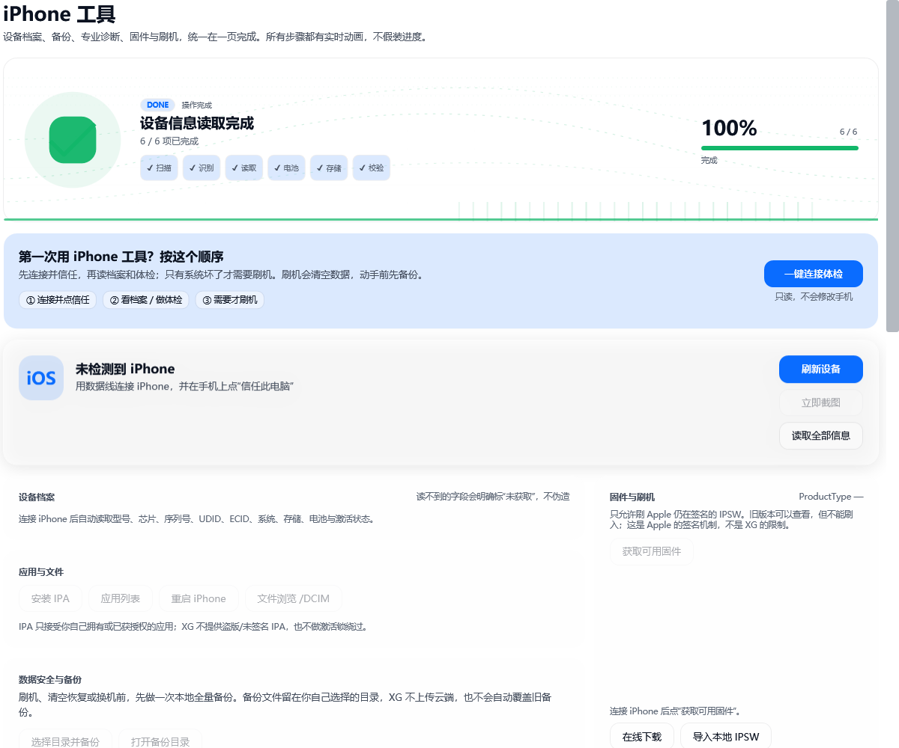
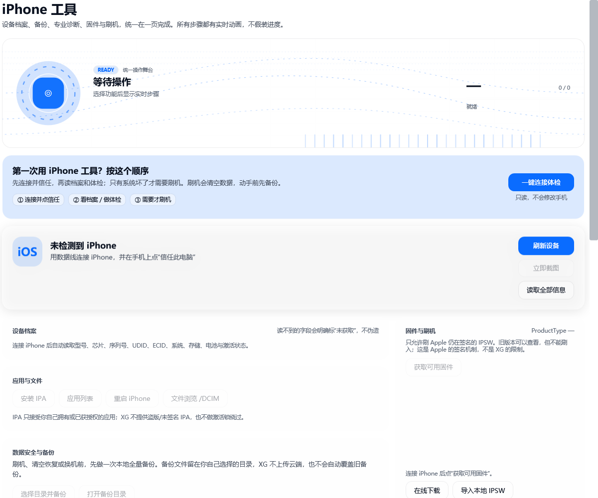

# XG Work Phone

**Android / Linux / iPhone 设备工作台，装进一台 Windows 电脑。**

Root、Fastboot、ADB、无线 ADB、iOS 备份与诊断、驱动安装、救砖、Windows / Linux 原生系统部署，收在一个界面里。Android / Linux 的 USB 与 TCP ADB 协议由本项目自研，不依赖外挂 `adb.exe` / `fastboot.exe`。

[](https://github.com/XweXG/XG-Work-Phone/releases/tag/v1.9.3)
[](#系统要求)
[](https://dotnet.microsoft.com/)
[](#边界与合规)

---

## v1.9.3：无线 ADB 调试

这次在原生 ADB 客户端上加入无线调试，不调用 `adb.exe`，也不启动后台 `adb server`，不占 5037 端口。

- **USB 一键开启 5555**：手机先用 USB 连接并授权，程序读取手机 Wi-Fi IPv4，再通过 ADB 服务 `tcpip:5555` 请求 adbd 监听，随后用原生 TCP ADB 连接 `手机IP:5555`。成功后可以拔掉 USB 线。
- **手动连接无线设备**：填写 `IP:端口`（可省略端口，默认 5555），直接建立原生 TCP ADB 会话；适用于已经手动开启 `tcpip` 的设备，或 Linux 小机型。
- **断开当前无线连接**：从设备总线移除网络会话，不关闭手机端 5555 监听；需要时可以重新连接。
- **协议修正**：`adb tcpip` 是 ADB 主机服务，不是 Android shell 命令。v1.9.3 新增 `AdbClient.Tcpip(port)`，走 `tcpip:<port>` 服务，避免误执行 `adb shell tcpip 5555` 导致「命令不存在」。
- **设备总线**：网络会话不会被 USB 扫描误判为已拔出；无线端点断开后不自动重连，避免 5 秒 TCP 超时拖慢 2.2 秒轮询；离线会话保留，ADB 页显示「无线 ADB 已离线」并允许断开清理。
- **状态与刷新**：设备模型新增 `IsWireless`，连接文本显示「ADB 无线」；连接成功后立即刷新设备列表，不等定时器。

| 雾白 | 雾黑 |
|---|---|
|  |  |

---

## 下载 v1.9.3

当前发布版本：**v1.9.3**（Windows x64，自包含发布，不需要另装 .NET 运行时）。安装包未数字签名，首次运行如遇 SmartScreen 提示，请核对下方 SHA256。

| 文件 | 大小 | GitHub Release | 蓝奏云 |
|---|---:|---|---|
| `XGWorkPhone-Setup-1.9.3.exe` | 95.8 MB | [下载](https://github.com/XweXG/XG-Work-Phone/releases/download/v1.9.3/XGWorkPhone-Setup-1.9.3.exe) | [压缩包](https://wwayi.lanzoum.com/iwXTS4hdjd1i)，提取码 `85vz` |
| `XGWorkPhone-1.9.3-Windows-x64.zip` | 198.1 MB | [下载](https://github.com/XweXG/XG-Work-Phone/releases/download/v1.9.3/XGWorkPhone-1.9.3-Windows-x64.zip) | 超过免费单文件上限，请用安装包 |
| `XGWorkPhone.exe` | 87.0 MB | [下载](https://github.com/XweXG/XG-Work-Phone/releases/download/v1.9.3/XGWorkPhone.exe) | — |
| `XGWorkPhone-Setup-1.9.3.zip` | 95.8 MB | — | [下载](https://wwayi.lanzoum.com/iwXTS4hdjd1i)，提取码 `85vz` |

> 蓝奏云的 `XGWorkPhone-Setup-1.9.3.zip` 内含安装包、`README-v1.9.3.md`、`SHA256-v1.9.3.txt`，解压后双击 `XGWorkPhone-Setup-1.9.3.exe` 安装。
>
> 安装版按向导安装；便携版解压即用；单文件适合直接替换。更新已有版本：应用 → 设置 → 应用更新 → 导入更新包，选择 `.zip` 或 `.exe`。更新器会校验 PE、产品名、版本、大小与 SHA256，失败自动回滚。

### SHA256

```text
93378B2062BFF649E118E26D26C36BCE50F9D9C2EC42F583BFBBF8553DE54DB8  XGWorkPhone-Setup-1.9.3.exe
6E075A9E0649042A3AF2EC0B7C0667B49CDB47719CEA7F0C1CDFE186EEEB33B8  XGWorkPhone-1.9.3-Windows-x64.zip
85B6166F1071FAF2984291276770C63863E1FABB3CCCC1323D2668AF2988A8D8  XGWorkPhone.exe
```

---

## 能做什么

| 模块 | 能力 |
|---|---|
| **设备总览** | 2.2 秒轮询识别；型号、序列号、系统、电量、存储、解锁状态、Root 状态、A/B 槽位；EDL 9008 与 MTK BROM 端口识别 |
| **Android · Root** | Magisk / KernelSU / APatch 三条链路；导入已修补 boot 镜像后刷入并回读验证；镜像体检（boot v0–v4、vendor_boot、页大小、截断、分区错配） |
| **Android · Fastboot** | boot / init_boot / recovery / vbmeta / 自定义分区刷写；擦除、解锁、切槽、`getvar`、重启；临时启动镜像只加载到内存，不写分区 |
| **Android · ADB** | 单 APK / 分割 APKS 安装、卸载、包列表、截图、录屏、推拉文件、logcat、input、settings、Shell 终端；设备体检、应用详情 / 提取 APK / 清数据 / 停用启用；小白一键操作逐项标注真实命令与风险 |
| **Android · 无线 ADB** | USB 一键开启 5555 后拔线；手动 `IP:端口` 原生 TCP 连接；断开无线会话；离线会话保留与清理 |
| **Android · 救砖** | 软砖自动恢复、Magisk 模块移除、深砖 9008 / BROM 分级处置；所有镜像缺失时明确报失败，不假装完成 |
| **Android · 驱动** | Google 官方 ADB 驱动一键下载 / 解压 / `pnputil` 入库；厂商 INF 导入；扫描异常设备并给出人话建议；pnputil 退出码与驱动库双重校验 |
| **iPhone** | 设备档案、恢复模式 / DFU 真实识别、ipsw.me 固件库、在线下载 / 本地 IPSW 导入、`idevicerestore` 刷机、IPA 安装、应用列表、截图、重启；基于 `idevicebackup2 1.3.0` 的本地全量备份；6 组只读诊断；`/DCIM` 只读文件浏览；越狱兼容性检测（可选模块，不捆绑 exploit） |
| **安装 Windows** | 独立页面：Fastboot 实刷社区 UEFI 到 `boot` / `boot_a` / `boot_b`；可选直刷 Windows 原始分区镜像；可选 ARM64 `install.wim` 生成 WinPE 部署包（diskpart + DISM + bcdboot） |
| **安装 Linux** | 独立页面：Fastboot 直刷 boot / rootfs；大 rootfs 走 ADB `push + dd`（需 root），容量预检、退出码校验、重启后验证 Linux 真正启动 |
| **机型与系统** | 179 条机型 / 22 品牌；品牌筛选与搜索；自定义机型新增 / 编辑 / 删除 / JSON 导入导出 / 模板；Markdown 部署检查单；分区规划与 PowerShell 草案导出 |
| **互联与投屏** | 手机画面实时预览（原生 `screencap`）；电脑桌面经 `adb reverse` + 本机 MJPEG 服务在手机浏览器全屏查看 |
| **界面** | 无边框窗口、雾白 / 雾黑双主题、460ms 主题过渡、620ms 页面切换；220px 线条动画舞台，55 个线条元素，真实进度轨与三态反馈 |

### 动画舞台



### iPhone 工具页



---

## 系统要求

- Windows 10 / 11 x64。
- 安装版、便携版、单文件均为自包含发布，不需要单独安装 .NET 8 Runtime。
- Android 功能需要可用 USB 数据线与手机端 USB 调试授权；Fastboot 需要 Bootloader 已解锁。
- 无线 ADB 需要手机与电脑处于同一个可信 Wi-Fi；手机端需已开启 `tcpip` 监听，或先用 USB 完成一次「一键开启 5555」。
- iPhone 备份 / 普通模式读取需要 Apple Mobile Device Service（iTunes 或 Apple Devices 自带）；恢复模式 / DFU 识别与刷机依赖项目内置的 `idevicerestore` 工具链。

## 安装

1. 下载 `XGWorkPhone-Setup-1.9.3.exe`，双击安装；或解压 `XGWorkPhone-1.9.3-Windows-x64.zip` 直接运行。
2. 需要装驱动时，右键以管理员身份运行应用，进入「驱动安装」。
3. 手机端开启开发者选项与 USB 调试，连接后在「设备总览」授权。
4. 无线 ADB：USB 在线时打开「ADB 工具箱 → 无线 ADB 调试（Wi-Fi）」，点「USB 一键开启 5555」；成功后拔线。也可直接填写已开启的 `IP:5555` 连接。
5. iPhone 备份前先安装 Apple Mobile Device Service；应用会在 iPhone 工具页显示工具链状态。

## 边界与合规

- 只操作自己拥有的设备，并遵守当地法律与厂商条款。
- 解锁 Bootloader 会清空数据并可能影响保修。
- **不做**激活锁 / iCloud 绕过、盗版或未签名 IPA、任意降级、防数据恢复、修复电池健康、内置越狱 exploit。
- 无线 ADB 当前是经典 `tcpip 5555`，不是 Android 11 的无线调试配对 / TLS 流程；Android 11+ 若只打开「无线调试」配对，仍需先通过 USB 执行一次 `tcpip 5555`，或等待后续实现配对协议。
- 本机没有真实 Android 手机，Wi-Fi IP 读取与厂商 ROM 的 `tcpip:` 行为未做真机验收；虚拟服务器只验证协议与界面。
- 无真机环境下完成的协议与 UI 冒烟，不等同于所有机型、所有系统版本的端到端验收；真机问题请附日志与机型信息提 Issue。
- 安装包当前未做代码签名，请用 Release 页的 SHA256 校验下载完整性。
- 本仓库用于发布、说明与问题反馈；源码不在公开仓库。

## 反馈

- [提交 Issue](https://github.com/XweXG/XG-Work-Phone/issues)
- [查看全部 Release](https://github.com/XweXG/XG-Work-Phone/releases)
- 反馈时请附：Windows 版本、手机型号 / 系统、连接方式（ADB / 无线 ADB / Fastboot / DFU）、复现步骤、日志面板导出的原文。

---

<sub>XG Work Phone · Windows 设备工作台 · v1.9.3 · 2026-11-26</sub>
